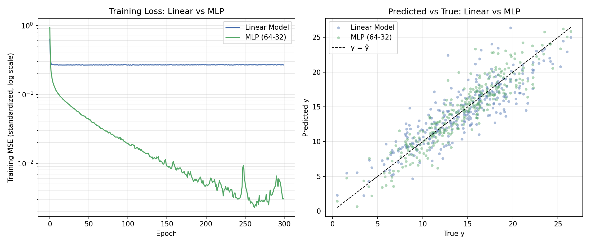

# 可视化：直观比较两个模型

- **左图（训练损失对比，对数坐标）**：线性模型（蓝）的损失迅速收敛到约 0.27 后几乎不再下降，说明模型已达到其表达能力的上限；MLP（绿）的损失持续下降到约 0.003，低两个数量级，说明非线性结构让模型能继续学习数据中更细致的规律。
- **右图（预测值 vs 真实值，两模型叠加）**：MLP（绿色点）整体更贴近对角线 `y = ŷ`，尤其是在 y 取值较大或较小的两端，线性模型（蓝色点）的"收缩"现象（预测值挤在中间）在 MLP 上明显减轻。

单独的 MLP 预测散点图见 [`mlp_scatter.png`](./mlp_scatter.png)。
