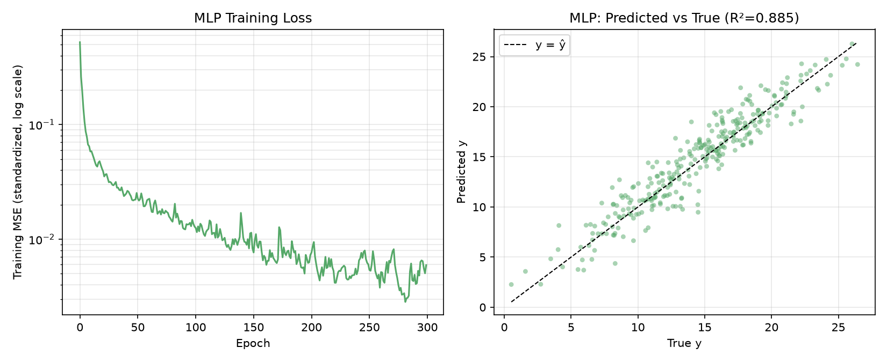
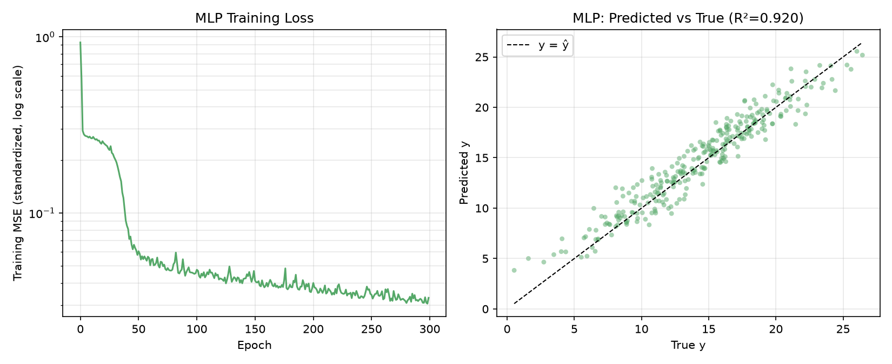
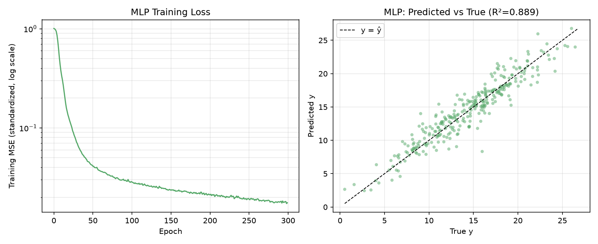
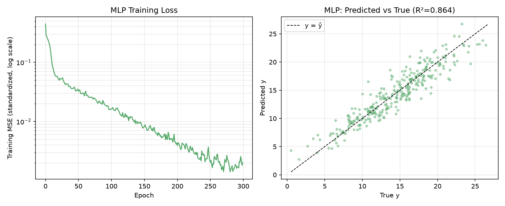

# ReLu原图：

# 改变激活函数为Leaky ReLu：

# 改变激活函数为Sigmoid：

# 改变激活函数为Softmax：

# 改变激活函数为Tanh：

# 对比结果
- 改变激活函数后拟合效果没有变化，可能是因为数据较简单。
- 对于损失函数：
- - LeakyReLu没有显著变化，
- - Sigmoid和Softmax的损失函数值都偏大，Sigmoid最后变化较平缓，Softmax的最后变化比Sigmoid更平缓，
- - Tanh的效果改变要在后期体现，因为其下降较平缓。