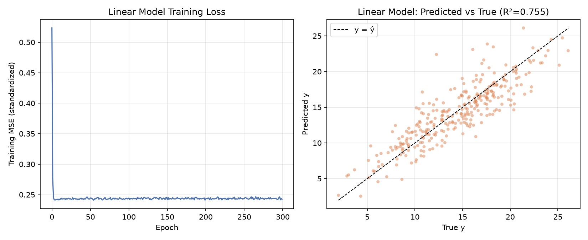
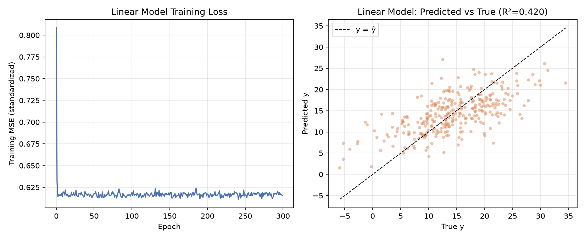
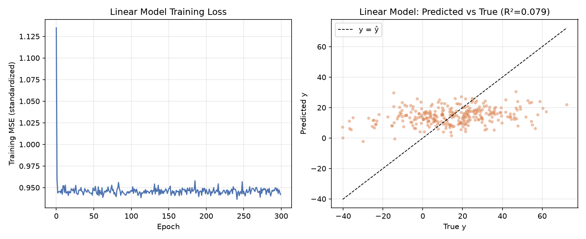
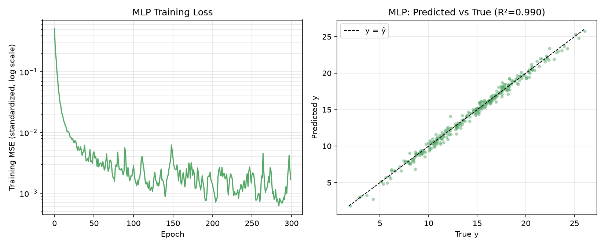
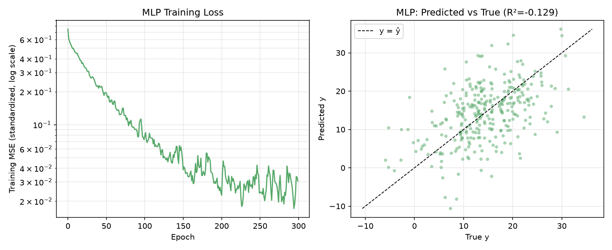
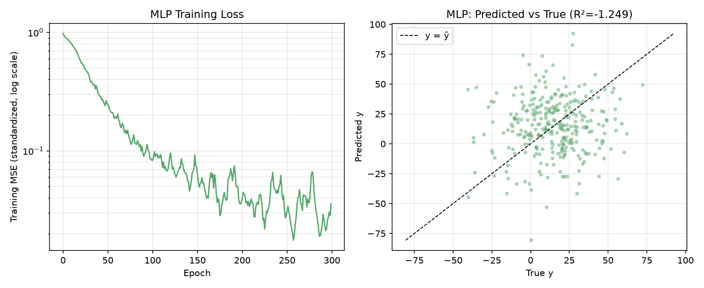

# 数据噪声增加以后，模型性能发生了什么变化？
- 模型的损失函数值增大，拟合效果下降
# 两类模型受到的影响是否完全相同？
- 不完全相同
- - MLP模型所受影响明显小于线性模型；
- - MLP模型的拟合效果更均匀，线性模型的拟合效果更分散。
# 当数据本身存在较大随机性时，单纯增加模型复杂度是否仍然有效？
- 无效，由测试结果来看，MLP模型在面对较大随机性数据时拟合效果任然有较大下降。
# 线性
## 0.1

## 1.0

## 5.0

## 20.0

# MLP
## 0.1

## 1.0

## 5.0

## 20.0
